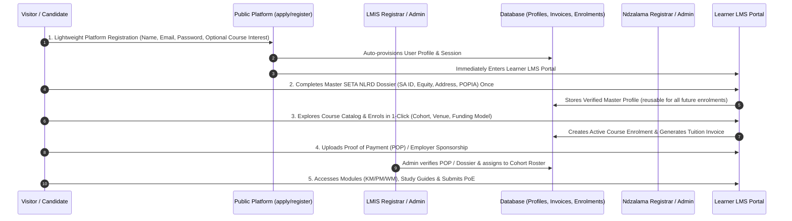

# Ndzalama Training — Unified Public Portal, LMIS & LMS Master Blueprint & Schema Specification

**Document Version:** 2.1.0  
**Target Domain:** `ndzalama.co.za` / `ndzalama.org.za`  
**Architecture:** Unified Next.js 16 (App Router) + TypeScript + Supabase PostgreSQL (`.sql` migrations) + Supabase Auth & RLS + Role-Based Access Control (RBAC)  
**Accreditation Frameworks:** ETDP SETA (Accreditation No: `ETDP0204`), SAQA (ODETDP `50334`), QCTO (Occupational Certificates & Skills Programmes)

---

## 1. Executive Architecture & System Overview

Ndzalama Training operates as an integrated, multi-tier education and training management ecosystem accessible under a **single primary URL (`ndzalama.co.za` / `ndzalama.org.za`)**. 

The system unifies three core operational engines:
1. **Public Discovery & Dynamic Content Engine:** Marketing, dynamic posts/news/updates, SEO-optimised course catalogues, schedules, online enquiry/booking, and instant public credential verification.
2. **Learner & Labour Market Information System (LMIS):** Full lifecycle management of learners, lead qualification, compliance document collection (ID, Matric, POPIA), cohort scheduling, workplace host employer management, logbook tracking, stipend administration, and SETA NLRD / QCTO compliance reporting.
3. **Learning Management System (LMS):** Digital course delivery for occupational qualifications and short courses (Knowledge Modules, Practical Skills, Workplace Experience), Portfolio of Evidence (PoE) submission workflows, assessor rubric marking, moderator sampling and verification, and automated cryptographic certificate issuance.

```
                                  ┌────────────────────────────────────────────────────────┐
                                  │      UNIFIED DOMAIN: ndzalama.co.za / .org.za          │
                                  └───────────────────────────┬────────────────────────────┘
                                                              │
                                                              ▼
                                  ┌────────────────────────────────────────────────────────┐
                                  │       Next.js 16 App Router & Edge RBAC Middleware     │
                                  └──────┬────────────────────┬────────────────────┬───────┘
                                         │                    │                    │
          ┌──────────────────────────────┴──────┐             │             ┌──────┴──────────────────────────────┐
          ▼                                     ▼             │             ▼                                     ▼
┌───────────────────────────┐         ┌───────────────────┐   │   ┌───────────────────┐         ┌───────────────────────────┐
│       PUBLIC PORTAL       │         │  SUPABASE AUTH    │   │   │     LMIS ENGINE   │         │         LMS ENGINE        │
│ • Dynamic News & Posts    │         │ • JWT / Session   │   │   │ • Learner Pipeline│         │ • Knowledge Modules (KM)  │
│ • Course & Unit Std Cat.  │         │ • Role Claims     │   │   │ • SETA NLRD Export│         │ • Practical Modules (PM)  │
│ • Intake Schedules        │         │ • Auto-Profiles   │   │   │ • Host Employers  │         │ • Digital PoE Submissions │
│ • Online Booking / Leads  │         │ • Password Reset  │   │   │ • Logbook Audits  │         │ • Assessor / Moderator QA │
│ • Public Cert Verify      │         │ • RBAC Routing    │   │   │ • Invoicing & SDL │         │ • Automated Certificates  │
└───────────────────────────┘         └───────────────────┘   │   └───────────────────┘         └───────────────────────────┘
                                                              │
                                                              ▼
                                  ┌────────────────────────────────────────────────────────┐
                                  │             SUPABASE POSTGRESQL DATABASE               │
                                  │       (Row-Level Security + Native SQL Migrations)     │
                                  └────────────────────────────────────────────────────────┘
```

---

## 2. Unified URL & Role-Based Access Control (RBAC)

All users enter through the same domain. The **Next.js Middleware** acts as an edge router, inspecting authentication status and token claims to direct users to their dedicated workspace while keeping the URL clean and intuitive.

### 2.1 Role Hierarchy & Permissions

| Role | Target Route | Primary Responsibilities | Access Scope |
| :--- | :--- | :--- | :--- |
| **VISITOR / GUEST** | `/`, `/courses`, `/posts`, `/apply` | Browse offerings, read dynamic news, submit application leads, verify certificates | Public read & submission endpoints |
| **LEARNER** | `/dashboard/learner` (or `/learner`) | Complete learning modules, download guides, upload PoEs, track results, access certificates | Enrolled courses, own submissions & profile |
| **FACILITATOR** | `/dashboard/facilitator` | Manage cohort attendance, post announcements, provide class resources, track completion | Assigned cohorts and learner groups |
| **ASSESSOR** | `/dashboard/assessor` | Evaluate submitted PoEs against SAQA/QCTO rubrics, declare C/NYC, provide remediation notes | Assigned assessment submissions |
| **MODERATOR** | `/dashboard/moderator` | QA sample review (10-20%), validate assessment integrity, generate internal moderation reports | Cohort assessment batches |
| **SME_MENTOR** | `/dashboard/mentor` | Oversee workplace practicals, verify logbook entries at host employer sites | Assigned learners in workplace placement |
| **HOST_EMPLOYER**| `/dashboard/employer` | Monitor sponsored/placed learners, approve attendance, view SDL progress reports | Sponsored enterprise learners |
| **ADMIN / REGISTRAR**| `/dashboard/admin` | Learner registrations, SETA/QCTO reporting, schedule planning, accreditation maintenance | Full operational data & management |
| **FINANCE** | `/dashboard/finance` | Invoicing, payment reconciliations, stipend disbursement tracking | Financial records and billing states |
| **SUPER_ADMIN** | `/dashboard/admin` | Platform configurations, user role assignments, audit logs, system maintenance | Unrestricted root platform access |

---

## 3. Dynamic Public Portal & LMIS Integration Flow

The public layer is not merely a static brochure; it is the intake funnel directly feeding the LMIS data pipeline.



---

## 4. Course & Curriculum Organisation Framework

Ndzalama delivers programmes across three distinct South African educational structures:
1. **Legacy NQF Unit Standard Qualifications:** e.g., *National Certificate: OD-ETDP (SAQA ID: 50334, NQF Level 5, 120+ Credits)* comprised of standalone accredited short courses (Facilitator `117871`, Assessor `115753`, Moderator `115759`, SDF `114924`, Coaching `15221`, Course Design `123401`).
2. **QCTO Occupational Certificates:** Modern curriculum divided into three mandatory sub-components:
   - **Knowledge Modules (KM):** Theoretical foundations and concepts.
   - **Practical Skill Modules (PM):** Simulated application and practical exercises.
   - **Work Experience Modules (WM):** Structured workplace logbook activities verified by a workplace mentor.
3. **Skills Programmes & Short Courses:** Workplace Preparation (`SP-201201`), Workplace Essential Skills (`SP-211009`), and custom corporate executive training.

### Curriculum Data Model Representation:

```text
QUALIFICATION / PROGRAMME (e.g., OC: Training Development Practitioner - SAQA 101321)
 │
 ├── KNOWLEDGE MODULES (KM)
 │    ├── KM-01: Foundation of Education & Training
 │    │    ├── Topic 1: Adult Learning Theories
 │    │    └── Topic 2: Facilitation Methodologies
 │    └── KM-02: Learning Programme Design
 │
 ├── PRACTICAL SKILL MODULES (PM)
 │    ├── PM-01: Facilitate Learning Sessions (Simulated)
 │    │    └── Activity: 20-min Recorded Facilitation Video Submission
 │    └── PM-02: Conduct Competence Assessments
 │
 └── WORK EXPERIENCE MODULES (WM)
      ├── WM-01: Workplace Training Delivery (Logbook)
      └── WM-02: Workplace Assessment & Moderation Portfolio
```

---

## 5. Supabase Database Design & Migration Specification

The canonical SQL migration is maintained in [`supabase/migrations/20260819_ndzalama_init_schema.sql`](file:///d:/Illumyn/Projects/EbullientTheory/Ndzalama-MIS/supabase/migrations/20260819_ndzalama_init_schema.sql).

### Key Architectural Highlights in SQL:
1. **Supabase Auth Hook (`handle_new_user`)**: Auto-creates a synchronized `public.profiles` record with default role `learner` upon Supabase authentication signup.
2. **Comprehensive Demographic & NLRD Fields**: Full SA ID/Passport validation, equity codes, disability classifications, citizen status, and POPIA consent tracking.
3. **Row-Level Security (RLS)**:
   - `profiles`: Self view/update, admin full access.
   - `posts`: Public read for published articles, staff full edit.
   - `qualifications` & `course_modules`: Public read, admin manage.
   - `applications`: Applicant self view/insert, admin review.
   - `enrollments` & `assessment_submissions`: Learner self view/submit, staff evaluate.
   - `certificates`: Public verification by certificate number or SHA-256 hash.

---

## 6. Actionable UI/UX, Design & Flow Improvements

### 6.1 Public Website Design Enhancements
- **Dynamic Post / Updates Feed on Homepage & `/posts`:** Implement a dynamic news carousel and regulatory update widget (highlighting ETDP SETA accreditation news, upcoming registration deadlines, and occupational certificate changes).
- **Interactive Course Finder & Unit Standard Calculator:** Allow corporate clients to calculate combo discounts (e.g. Facilitator + Assessor + Moderator = R8,400) and view credits instantly.
- **Modern Glassmorphism & Micro-animations:** Upgrade `globals.css` with sleek emerald/navy design tokens, subtle card hover elevations, and tabbed unit standard views.
- **Real-Time Certificate Verifier (`/verify`):** Build a high-trust verification page where employers can input a certificate number or scan a QR code to view verified SAQA credits.

### 6.2 LMIS (Operations) Flow Enhancements
- **Application-to-Enrollment Pipeline (Kanban & Table View):** Add stage-based drag-and-drop lead tracking (New Application -> Verification -> Invoice -> Active Learner).
- **SETA / NLRD Data Export Generator:** Provide one-click `.csv` / `.xlsx` exports formatted to strict ETDP SETA specifications.
- **Host Employer & Workplace Logbook Dashboard:** Dedicated view for tracking workplace placement hours (WM modules) for Occupational Certificate learners.

### 6.3 LMS Delivery Flow Enhancements
- **Multi-File PoE Dropzone:** Drag-and-drop uploader supporting PDFs, signed logbooks, video recordings, and formative worksheets.
- **Assessor Marking & Rubric Workbench:** Split-screen interface showing the learner's uploaded evidence alongside the SAQA unit standard rubric criteria with instant C/NYC toggle.
- **Moderator QA Sampling Tool:** Automatic 10% random sample generation across submitted cohorts with audit-ready moderation report exports.

---

## 7. Migration & Implementation Roadmap

1. **Phase 1 — Supabase SQL Database Migration:**
   - Execute [`supabase/migrations/20260819_ndzalama_init_schema.sql`](file:///d:/Illumyn/Projects/EbullientTheory/Ndzalama-MIS/supabase/migrations/20260819_ndzalama_init_schema.sql) in your Supabase SQL Editor.
   - Seed core Ndzalama qualifications (Facilitator, Assessor, Moderator, SDF, ODETDP, ECD, Occupational Trainer).
2. **Phase 2 — Supabase Auth & Unified RBAC Middleware:**
   - Configure `@supabase/ssr` / Supabase Auth with role-based edge middleware redirects.
   - Implement dynamic posts and blog system in `src/app/(public)/posts`.
3. **Phase 3 — LMIS Pipeline & Application Processing:**
   - Connect `/apply` form to create applicant records and store compliance documents.
   - Build Admin review and cohort assignment dashboard.
4. **Phase 4 — LMS Digital PoE & Assessment Workflows:**
   - Implement learner module viewer and PoE upload system.
   - Build Assessor evaluation interface and Moderator QA sampling engine.
5. **Phase 5 — Certificate Engine & SETA Exports:**
   - Generate cryptographic certificates with verifiable QR codes.
   - Implement automated NLRD SETA compliance reporting.
