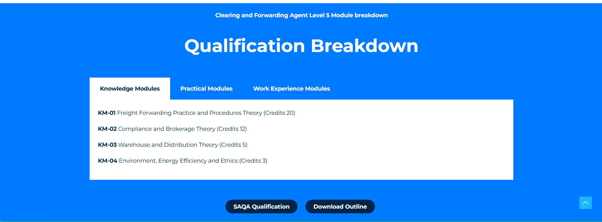

**NDZALAMA TRAINING**

**Website Site Map & Page-by-Page Content Plan**

*Detailed version — includes a full page template for every one of the 16 qualifications you're applying for or already hold, with reference screenshots from the sites you shortlisted so your designer/developer can match the intended layout.*

*Green tag = Accredited. Amber tag = Accreditation applied for. Regulatory fields (NQF level, credits, duration, module names) were cross-checked against several publicly available SETA/QCTO sources for these course codes — confirm every figure against your own accreditation certificates and gazetted curricula before publishing, since minor discrepancies exist across public sources. All marketing/descriptive copy (introductions, “who should attend”, career-opportunity wording) was independently drafted for Ndzalama and is not copied from any training provider's website — treat it as a first draft to edit into your own voice, not final copy.*

# **1\. Site Map**

Top-level navigation:

-   Home
-   Our Courses (mega-menu — see Section 3)
-   About Us
-   Contact Us
-   Enrol / Enquire (utility button, always visible in header)

| **NOTE:** _Because several qualifications are still “applied for” rather than accredited, keep an accreditation-status field on every course record. Never state or imply a course is accredited before the applicable SETA/QCTO confirms it._ |
| --- |

# **2\. Home Page**

## **2.1 Introduction Section**

-   Tagline (3–4 words): "Building Skills. Transforming Futures."
-   Sub-line: 20+ years of experience delivering accredited occupational qualifications, skills programmes and workplace training across Limpopo and beyond.
-   Quick-action buttons: Browse Courses | Training Schedule | Enrol Now | Request Proposal

## **2.2 “Find the Right Training Solution” Split Path**

### **For Individuals**

Take the next step in your career with nationally recognised qualifications and skills programmes designed for today's workplace.

Click Here: (takes to) Our Courses

### **For Organisations**

Strengthen your workforce with accredited training solutions designed to meet your organisation's skills development and compliance needs.

Buttons: Enquiry Form (complete form): Name and Surname, Company Name, Training Programme(s) interested in, Location, How can we help you?; Option to Download Company Profile

## **2.3 Training Options Strip**

Flexible Training Delivery

Choose the training option that best suits your learning style, schedule or organisational needs.

**In-Person Training**

Attend instructor-led training at one of our training venues in a collaborative learning environment.

**Onsite Training**

We'll come to you. We deliver customised training at your workplace, minimising disruption while developing your team's skills.

**Online & Virtual Training**

Learn from anywhere through live virtual sessions or online learning, without compromising on quality or support.

## **2.4 Credibility Strip**

Short stats row, mirroring the reference sites' “24+ years / 50+ staff / 500+ clients” format:

-   20+ Years in Training
-   X of Accredited Programmes
-   9 Provinces Served
-   B-BBEE Level 2

*Reference: stats/credibility strip layout*

| **NOTE:** _Only publish figures you can stand behind. Placeholder categories above need Ndzalama's real counts before launch._ |
| --- |

## **2.5 Training Calendar Banner**

Wide banner: “Explore Our \[Year\] Training Calendar” with a line on browsing dates/locations, and two buttons — View Schedule (secondary/white) – link to PDF

*Reference: training calendar banner layout*

## **2.6 Contact Strip (footer-adjacent)**

Three columns: Address (with map pin) · Opening Hours (weekday hours; weekend = online/email only) · Social Media icons. Contact Details: Phone, Email etc)

*Reference: contact strip: Address / Opening Hours / Social Media*

# **3\. Our Courses (Mega-Menu & Landing Page)**

On hover/click, the nav item opens a mega-menu with the full category tree below, so a visitor can jump straight to a specific qualification. The same tree becomes the content of the standalone “Our Courses” landing page.

*Reference: mega-menu category layout (multi-column, grouped headings)*

### **Occupational Certificates**

### **Education & Training**

-   Occupational Trainer (OC-97154) **\[Applied for accreditation\]**
-   Training and Development Practitioner (OC-101321) **\[Applied for accreditation\]**
-   Early Childhood Development Practitioner (OC-97542) **\[Applied for accreditation\]**

### **Health & Safety**

-   Occupational Health and Safety Officer (OC-121929) **\[Accredited\]**
-   Occupational Health and Safety Assistant (OC-121930) **\[Accredited\]**

### **QCTO Skills Programmes**

### **Learning & Development**

-   Learning and Development Facilitator (SP-220319) **\[Applied for accreditation\]**
-   Assessment Practitioner (SP-220320) **\[Applied for accreditation\]**
-   Skills Development Facilitation Practitioner (SP-220321) **\[Applied for accreditation\]**
-   Workplace-based Practitioner Programme (SP-220322) **\[Accredited (verified 14 May 2026)\]**
-   Assistant Life Coach (SP-211001) **\[Applied for accreditation\]**

### **Business, Entrepreneurship & Employability**

-   Workplace Preparation (SP-201201) **\[Accredited\]**
-   Workplace Essential Skills (SP-211009) **\[Accredited\]**
-   New Venture Creation (SP-2110010) **\[Applied for accreditation\]**

### **First Aid**

-   Basic Emergency First Aid Responder (SP-230801) **\[Accredited\]**
-   Intermediate Emergency First Aid Responder (SP-230802) **\[Accredited\]**
-   Advanced Emergency First Aid Responder (SP-230803) **\[Accredited\]**

Each category landing block ends with an “EXPLORE COURSES” call-to-action introducing the course cards (Section 4).

**EXPLORE COURSES**

Search bar for different courses

Then the Course Listing Cards…

# **4\. Course Listing Cards**

Each course, wherever it appears as a card (category page, search results, related-courses), shows:

-   Label — e.g. “QCTO SKILLS PROGRAMME” or “OCCUPATIONAL CERTIFICATE”
-   Course name
-   Reference number (OC-/SP-), NQF Level, Credits
-   Duration
-   Accreditation status badge — Accredited (green) / Accreditation Applied For (amber)
-   “View Qualification” button → links to the individual course page

*Reference: individual course card layout*

# **5\. Individual Course / Qualification Page (Master Template)**

One template reused for every course (different images relevant to the qualifications). Sections in order — see Section 6 for this template filled in for all 16 qualifications:

*Reference: course page hero: name, NQF/credits, accreditation badge, key facts, CTA*

-   **Header:** course name, reference number, NQF level, credits, accreditation-status badge, hero image
-   **Course Introduction:** what it is and who it's for
-   **Who Should Attend**
-   **Entry Requirements**
-   **Learning Outcomes**
-   **Our Training Methodology:** in-person / online / onsite, practical vs theory split

*Reference: qualification breakdown: tabbed Knowledge / Practical / Work Experience modules*

-   **Course / Module Content**
-   **Assessments & Certification**
-   **Career Opportunities**
-   **Calls to action:** Download Brochure · Enquire / Enrol button

# **6\. Course Pages — Full Content (All 16 Qualifications)**

Populated per the template above. Green = Accredited. Amber = Accreditation applied for. Wording for amber courses should stay conditional (“accreditation applied for”) until confirmed.

## **6.1 Occupational Certificates — Education & Training**

**OCCUPATIONAL CERTIFICATE**

**Occupational Trainer \[Applied for accreditation\]**

**OC-97154 · NQF Level 4 · 124 Credits**

**Duration:** Typically 12–18 months (provider-paced)

**Accrediting body:** ETDP SETA (Development Quality Partner) / QCTO

### **Course Introduction**

Equips learners with the skills to plan a training session from scratch, choose methods and materials suited to the audience in front of them, and judge whether the learning has actually landed.

### **Who Should Attend**

Aspiring and practising trainers, in-house facilitators, and subject-matter experts moving into a formal training role.

### **Entry Requirements**

NQF Level 4 (Grade 12) or equivalent, with Communication competence.

### **Learning Outcomes**

-   Prepare for and facilitate training sessions
-   Select and adapt training methods and aids for different audiences
-   Conduct basic assessment of learners
-   Evaluate and report on training sessions delivered

### **Our Training Methodology**

Delivered in-person, onsite at the client's premises, or online/virtual — Knowledge, Practical and (where applicable) Work Experience modules, culminating in a Final Integrated Summative Assessment (FISA).

### **Course / Module Content**

-   Knowledge Modules — the training environment, adult learning principles
-   Practical Skill Modules — preparing and delivering a training session
-   Work Experience Module — facilitating a real training session in the workplace

### **Assessments & Certification**

Learners are assessed internally against each module, then complete a Final Integrated Summative Assessment (FISA) set/moderated externally. On success, the QCTO issues the official certificate/Statement of Results.

### **Career Opportunities**

-   In-house / corporate trainer
-   Skills development facilitator support role
-   Pathway to NQF 5 qualifications such as Training and Development Practitioner

**Calls to action: Download Brochure · Enquire / Enrol Now**

**OCCUPATIONAL CERTIFICATE**

**Training and Development Practitioner \[Applied for accreditation\]**

**OC-101321 · NQF Level 5 · 190 Credits**

**Duration:** 12–24 months

**Accrediting body:** ETDP SETA (Development Quality Partner) / QCTO

### **Course Introduction**

A full occupational qualification for anyone running the learning function end-to-end — from working out what a workplace actually needs to learn, through to planning, delivering and coordinating that training across an organisation.

### **Who Should Attend**

HR and L&D staff, training coordinators, and experienced facilitators who want a full occupational qualification rather than individual skills programmes.

### **Entry Requirements**

NQF Level 4 (Grade 12) with Communication.

### **Learning Outcomes**

-   Analyse learning and development needs within an occupational context
-   Facilitate learning using adult learning principles and techniques
-   Plan, implement and evaluate work-based learning interventions
-   Plan and conduct assessments in a variety of occupational contexts
-   Coordinate and manage learning and development within an organisation

### **Our Training Methodology**

Delivered in-person, onsite at the client's premises, or online/virtual — Knowledge, Practical and (where applicable) Work Experience modules, culminating in a Final Integrated Summative Assessment (FISA).

### **Course / Module Content**

-   7 Knowledge Modules
-   7 Practical Skill Modules
-   7 Work Experience Modules — all compulsory

### **Assessments & Certification**

Learners are assessed internally against each module, then complete a Final Integrated Summative Assessment (FISA) set/moderated externally. On success, the QCTO issues the official certificate/Statement of Results.

### **Career Opportunities**

-   Training and Development Practitioner
-   Learning & Development Coordinator
-   Skills Development Facilitator (with further specialisation)

**Calls to action: Download Brochure · Enquire / Enrol Now**

**OCCUPATIONAL CERTIFICATE**

**Early Childhood Development Practitioner \[Applied for accreditation\]**

**OC-97542 · NQF Level 4 · 131 Credits**

**Duration:** 12–18 months (confirm against final gazetted curriculum)

**Accrediting body:** ETDP SETA (Development Quality Partner) / QCTO

### **Course Introduction**

Builds the confidence and know-how to plan activities suited to a child's age and stage, and to run an early-learning space that's both safe and genuinely stimulating.

### **Who Should Attend**

ECD centre practitioners, aspiring crèche/pre-school staff, and community-based early learning workers.

### **Entry Requirements**

NQF Level 3 or equivalent (confirm against final curriculum); Communication competence recommended.

### **Learning Outcomes**

-   Facilitate age-appropriate early learning programmes
-   Create and maintain a safe, healthy learning environment for young children
-   Support children's holistic development (cognitive, social, physical, emotional)
-   Engage effectively with parents/caregivers and the community

### **Our Training Methodology**

Delivered in-person, onsite at the client's premises, or online/virtual — Knowledge, Practical and (where applicable) Work Experience modules, culminating in a Final Integrated Summative Assessment (FISA).

### **Course / Module Content**

-   Knowledge Modules — child development theory, health & safety
-   Practical Skill Modules — programme planning and facilitation
-   Work Experience Module — supervised placement in an ECD setting

### **Assessments & Certification**

Learners are assessed internally against each module, then complete a Final Integrated Summative Assessment (FISA) set/moderated externally. On success, the QCTO issues the official certificate/Statement of Results.

### **Career Opportunities**

-   ECD Practitioner / Facilitator
-   Crèche or pre-school assistant / supervisor
-   Community ECD outreach worker

**Calls to action: Download Brochure · Enquire / Enrol Now**

## **6.2 Occupational Certificates — Health & Safety**

**OCCUPATIONAL CERTIFICATE**

**Occupational Health and Safety Officer \[Accredited\]**

**OC-121929 · NQF Level 4 · 120 Credits**

**Duration:** 12–18 months full-time, up to 24 months part-time

**Accrediting body:** HWSETA (Development Quality Partner) / QCTO · SAQA ID 121929

### **Course Introduction**

Trains learners to spot hazards before they become incidents, manage day-to-day workplace risk, and keep an organisation on the right side of South Africa's OHS Act — the full toolkit for a dedicated safety role.

### **Who Should Attend**

Aspiring and current safety officers, safety administrators, and anyone moving into a dedicated workplace-safety role.

### **Entry Requirements**

No formal pre-requisite; a sound understanding of English (reading/writing) is required to engage with the syllabus.

### **Learning Outcomes**

-   Identify workplace hazards and conduct risk assessments
-   Investigate and report on OHS incidents
-   Maintain OHS records, audits and compliance documentation
-   Apply South African OHS legislation in a workplace context
-   Support and coordinate a workplace safety management system

### **Our Training Methodology**

Delivered in-person, onsite at the client's premises, or online/virtual — Knowledge, Practical and (where applicable) Work Experience modules, culminating in a Final Integrated Summative Assessment (FISA).

### **Course / Module Content**

-   Knowledge Modules — OHS legislation, hazard identification, risk management
-   Practical Skill Modules — inspections, incident investigation, audits
-   Work Experience Module — supervised OHS duties in a real workplace

### **Assessments & Certification**

Learners are assessed internally against each module, then complete a Final Integrated Summative Assessment (FISA) set/moderated externally. On success, the QCTO issues the official certificate/Statement of Results.

### **Career Opportunities**

-   Occupational Health and Safety Officer / Inspector
-   SHE (Safety, Health & Environment) Officer
-   Compliance Officer
-   Pathway to OHS Practitioner (NQF 5)

**Calls to action: Download Brochure · Enquire / Enrol Now**

**OCCUPATIONAL CERTIFICATE**

**Occupational Health and Safety Assistant \[Accredited\]**

**OC-121930 · NQF Level 4 · 44 Credits**

**Duration:** 6 months – 2 years, depending on pace (part-qualification)

**Accrediting body:** HWSETA (Development Quality Partner) / QCTO · SAQA ID 121930

### **Course Introduction**

A practical entry point into workplace safety — covering the administration, coordination and compliance-tracking that keeps an OHS system running day to day.

### **Who Should Attend**

Entry-level candidates and administrative staff supporting a workplace safety function; a stepping stone toward the OHS Officer qualification.

### **Entry Requirements**

NQF Level 3 / Grade 11 or equivalent.

### **Learning Outcomes**

-   Perform OHS administration and records management
-   Support the key activities of an OHS function
-   Communicate effectively within the OHS discipline
-   Apply the fundamentals of workplace health and safety

### **Our Training Methodology**

Delivered in-person, onsite at the client's premises, or online/virtual — Knowledge, Practical and (where applicable) Work Experience modules, culminating in a Final Integrated Summative Assessment (FISA).

### **Course / Module Content**

-   Fundamentals of Occupational Health and Safety
-   Fundamentals of Representing Employees Regarding OHS Issues
-   Fundamentals of Communication within the OHS Discipline
-   OHS Administration and Record Management
-   Administer the Key Activities of an OHS Function

### **Assessments & Certification**

Learners are assessed internally against each module, then complete a Final Integrated Summative Assessment (FISA) set/moderated externally. On success, the QCTO issues the official certificate/Statement of Results.

### **Career Opportunities**

-   Occupational Health and Safety Assistant
-   OHS Administrator
-   Pathway to Occupational Health and Safety Officer (NQF 4, full qualification) and OHS Practitioner (NQF 5)

**Calls to action: Download Brochure · Enquire / Enrol Now**

## **6.3 QCTO Skills Programmes — Learning & Development**

**QCTO SKILLS PROGRAMME**

**Learning and Development Facilitator \[Applied for accreditation\]**

**SP-220319 · NQF Level 5 · 36 Credits**

**Duration:** 5 days contact time + Portfolio of Evidence + workplace module

**Accrediting body:** ETDP SETA / QCTO

### **Course Introduction**

Sharpens a facilitator's ability to plan a session, hold a room, and adapt on the fly — using methods that genuinely work for adult learners rather than a one-size-fits-all lecture.

### **Who Should Attend**

Trainers, subject-matter experts, and workplace coaches responsible for delivering training.

### **Entry Requirements**

NQF Level 4 with Communication; good comprehension of English.

### **Learning Outcomes**

-   Facilitate learning using different methodologies, training styles and techniques
-   Create engaging, learner-centred training environments
-   Align learning outcomes with unit standards / qualifications

### **Our Training Methodology**

Delivered in-person, onsite at the client's premises, or online/virtual — Knowledge, Practical and (where applicable) Work Experience modules, culminating in a Final Integrated Summative Assessment (FISA).

### **Course / Module Content**

-   Knowledge Module — the statutory learning and development environment (8 credits)
-   Knowledge Module — facilitation of learning in occupational contexts (8 credits)
-   Practical Skills Module — facilitate different methodologies and techniques (12 credits)
-   Work Experience Module — facilitate an occupational learning session (8 credits)

### **Assessments & Certification**

Learners are assessed internally against each module, then complete a Final Integrated Summative Assessment (FISA) set/moderated externally. On success, the QCTO issues the official certificate/Statement of Results.

### **Career Opportunities**

-   Learning and Development Facilitator
-   Corporate/in-house trainer
-   Credits count toward the Occupational Certificate: Training and Development Practitioner (OC-101321)

**Calls to action: Download Brochure · Enquire / Enrol Now**

**QCTO SKILLS PROGRAMME**

**Assessment Practitioner \[Applied for accreditation\]**

**SP-220320 · NQF Level 5 · 20 Credits**

**Duration:** 5 days contact time + Portfolio of Evidence

**Accrediting body:** ETDP SETA / QCTO

### **Course Introduction**

Teaches the practical craft of assessment — judging a learner's work fairly and consistently against set criteria, with enough rigour to act as a registered assessor in your own field.

### **Who Should Attend**

Facilitators, workplace supervisors and SMEs who need to formally assess learner competence.

### **Entry Requirements**

NQF Level 4 with Communication.

### **Learning Outcomes**

-   Plan an assessment against agreed criteria
-   Conduct fair, valid and reliable assessments
-   Provide constructive feedback to candidates
-   Maintain assessment records in line with QCTO requirements

### **Our Training Methodology**

Delivered in-person, onsite at the client's premises, or online/virtual — Knowledge, Practical and (where applicable) Work Experience modules, culminating in a Final Integrated Summative Assessment (FISA).

### **Course / Module Content**

-   Knowledge Module — principles and standards of occupational assessment
-   Practical Skill Module — conducting an assessment
-   Work Experience Module — assessing a learner in a real context

### **Assessments & Certification**

Learners are assessed internally against each module, then complete a Final Integrated Summative Assessment (FISA) set/moderated externally. On success, the QCTO issues the official certificate/Statement of Results.

### **Career Opportunities**

-   Registered Assessor (subject-matter/occupation specific)
-   Skills Development Facilitator support role
-   Credits count toward Training and Development Practitioner (OC-101321)

**Calls to action: Download Brochure · Enquire / Enrol Now**

**QCTO SKILLS PROGRAMME**

**Skills Development Facilitation Practitioner \[Applied for accreditation\]**

**SP-220321 · NQF Level 5 · 40 Credits**

**Duration:** Contact sessions + Portfolio of Evidence (confirm final schedule against curriculum)

**Accrediting body:** ETDP SETA / QCTO

### **Course Introduction**

Covers the full Skills Development Facilitator role — pulling together a company's skills plan, managing WSP/ATR submissions, and keeping training aligned with SETA and B-BBEE requirements.

### **Who Should Attend**

HR practitioners and training coordinators responsible for a company's skills development function.

### **Entry Requirements**

NQF Level 5 or equivalent HR/training experience recommended.

### **Learning Outcomes**

-   Coordinate the development of a Workplace Skills Plan (WSP) and Annual Training Report (ATR)
-   Advise management on skills development legislation and grant/levy processes
-   Support learnerships, internships and other structured programmes
-   Monitor and report on skills development implementation

### **Our Training Methodology**

Delivered in-person, onsite at the client's premises, or online/virtual — Knowledge, Practical and (where applicable) Work Experience modules, culminating in a Final Integrated Summative Assessment (FISA).

### **Course / Module Content**

-   Knowledge Modules — skills development legislation, WSP/ATR process
-   Practical Skill Modules — compiling and submitting skills plans
-   Work Experience Module — performing the SDF role in a real organisation

### **Assessments & Certification**

Learners are assessed internally against each module, then complete a Final Integrated Summative Assessment (FISA) set/moderated externally. On success, the QCTO issues the official certificate/Statement of Results.

### **Career Opportunities**

-   Skills Development Facilitator (SDF)
-   HR / Training Coordinator
-   B-BBEE Skills Development consultant

**Calls to action: Download Brochure · Enquire / Enrol Now**

**QCTO SKILLS PROGRAMME**

**Workplace-based Practitioner Programme \[Accredited (verified 14 May 2026)\]**

**SP-220322 · NQF Level 5 · 30 Credits**

**Duration:** 5 days contact time + Portfolio of Evidence

**Accrediting body:** ETDP SETA / QCTO — Verified 14 May 2026

### **Course Introduction**

Gives mentors and coordinators the tools to turn theory into practice — planning and running the on-the-job learning that makes a learnership or internship actually work.

### **Who Should Attend**

HR and L&D staff, mentors and workplace coordinators who support learnerships, internships and apprenticeships.

### **Entry Requirements**

NQF Level 4 or equivalent.

### **Learning Outcomes**

-   Facilitate learning in an occupational context
-   Plan and support work-based learning
-   Facilitate experiential work-based learning
-   Facilitate a work-based learning and development process

### **Our Training Methodology**

Delivered in-person, onsite at the client's premises, or online/virtual — Knowledge, Practical and (where applicable) Work Experience modules, culminating in a Final Integrated Summative Assessment (FISA).

### **Course / Module Content**

-   Knowledge Module
-   Practical Module
-   Workplace Module — all three compulsory, culminating in a Final Integrated Summative Assessment (FISA)

### **Assessments & Certification**

Learners are assessed internally against each module, then complete a Final Integrated Summative Assessment (FISA) set/moderated externally. On success, the QCTO issues the official certificate/Statement of Results.

### **Career Opportunities**

-   Work-Based Learning and Development Practitioner
-   Learnership / internship coordinator
-   Credits count toward the Occupational Certificate: Training and Development Practitioner (OC-101321, NQF 5, 190 credits)

**Calls to action: Download Brochure · Enquire / Enrol Now**

**QCTO SKILLS PROGRAMME**

**Assistant Life Coach \[Applied for accreditation\]**

**SP-211001 · NQF Level 5 · 30 Credits**

**Duration:** Contact sessions + Portfolio of Evidence (confirm schedule against curriculum)

**Accrediting body:** ETDP SETA / QCTO

### **Course Introduction**

Full title: Assistant Life Coach — Communication, Integrity and Confidence Coaching. Lays the groundwork for coaching practice — helping learners guide someone else through building confidence, communicating clearly, and setting goals that stick.

### **Who Should Attend**

Aspiring coaches, HR and wellness staff, and community/youth workers who want a foundation in coaching practice.

### **Entry Requirements**

NQF Level 4 with Communication recommended.

### **Learning Outcomes**

-   Apply core coaching communication techniques
-   Support a coachee's goal-setting and confidence-building process
-   Work within the ethical boundaries of an assistant coaching role

### **Our Training Methodology**

Delivered in-person, onsite at the client's premises, or online/virtual — Knowledge, Practical and (where applicable) Work Experience modules, culminating in a Final Integrated Summative Assessment (FISA).

### **Course / Module Content**

-   Knowledge Module — coaching principles and communication
-   Practical Skill Module — conducting a coaching conversation
-   Work Experience Module — supervised coaching practice

### **Assessments & Certification**

Learners are assessed internally against each module, then complete a Final Integrated Summative Assessment (FISA) set/moderated externally. On success, the QCTO issues the official certificate/Statement of Results.

### **Career Opportunities**

-   Assistant Life Coach
-   Wellness / HR support coach
-   Foundation for further coaching specialisation

**Calls to action: Download Brochure · Enquire / Enrol Now**

## **6.4 QCTO Skills Programmes — Business, Entrepreneurship & Employability**

**QCTO SKILLS PROGRAMME**

**Workplace Preparation \[Accredited\]**

**SP-201201 · NQF Level 2 · 30 Credits**

**Duration:** 5 days

**Accrediting body:** Services SETA / QCTO

### **Course Introduction**

A short, practical programme that gets first-time jobseekers ready for the working world — covering how to search for and land a job, manage yourself once you're in it, and handle everyday workplace conduct.

### **Who Should Attend**

Youth and first-time jobseekers, NEET (Not in Employment, Education or Training) candidates, and learners about to start a placement or internship.

### **Entry Requirements**

Open access — no formal pre-requisite.

### **Learning Outcomes**

-   Conduct self-evaluation of personal attributes and skills
-   Prepare for and manage job search and interviews
-   Manage work activities, time and personal money
-   Communicate effectively and work within a team
-   Solve workplace problems professionally and ethically
-   Protect self and others in the workplace

### **Our Training Methodology**

Delivered in-person, onsite at the client's premises, or online/virtual — Knowledge, Practical and (where applicable) Work Experience modules, culminating in a Final Integrated Summative Assessment (FISA).

### **Course / Module Content**

-   Single integrated skills programme covering job-readiness, workplace conduct and self-management — delivered over 5 days

### **Assessments & Certification**

Learners are assessed internally against each module, then complete a Final Integrated Summative Assessment (FISA) set/moderated externally. On success, the QCTO issues the official certificate/Statement of Results.

### **Career Opportunities**

-   Entry-level employment readiness across all sectors
-   Feeds into learnerships, internships and further Services SETA / QCTO programmes

**Calls to action: Download Brochure · Enquire / Enrol Now**

**QCTO SKILLS PROGRAMME**

**Workplace Essential Skills \[Accredited\]**

**SP-211009 · NQF Level 4 · 20 Credits**

**Duration:** 5 days contact time, plus practical application and assessment

**Accrediting body:** Services SETA / QCTO

### **Course Introduction**

Builds the everyday skills every employee needs — getting comfortable with workplace routines, pulling your weight in a team, and rolling with change rather than being thrown by it.

### **Who Should Attend**

New employees, apprentices, and learners who need a foundation of core workplace skills before or alongside a technical qualification.

### **Entry Requirements**

NQF Level 3 recommended.

### **Learning Outcomes**

-   Understand the workplace environment and employer/employee responsibilities
-   Apply Occupational Health and Safety awareness in the workplace
-   Work effectively within a team and organisation
-   Handle workplace induction, tasks and general procedures
-   Apply sound work ethics, norms and values

### **Our Training Methodology**

Delivered in-person, onsite at the client's premises, or online/virtual — Knowledge, Practical and (where applicable) Work Experience modules, culminating in a Final Integrated Summative Assessment (FISA).

### **Course / Module Content**

-   Knowledge Module topics: the workplace environment, employment, organisation of work, OHS awareness, workplace induction, work ethics
-   Application Component — practical demonstration of the above in a real or simulated workplace

### **Assessments & Certification**

Learners are assessed internally against each module, then complete a Final Integrated Summative Assessment (FISA) set/moderated externally. On success, the QCTO issues the official certificate/Statement of Results.

### **Career Opportunities**

-   Entry-level employment readiness across all sectors
-   Foundation for further Services SETA / QCTO skills programmes

**Calls to action: Download Brochure · Enquire / Enrol Now**

**QCTO SKILLS PROGRAMME**

**New Venture Creation \[Applied for accreditation\]**

**SP-2110010 · NQF Level TBC — confirm exact NQF level/credits against final gazetted curriculum · TBC Credits**

**Duration:** TBC — confirm against final curriculum

**Accrediting body:** Services SETA / QCTO

### **Course Introduction**

Walks a would-be entrepreneur from a raw idea through to a workable plan — testing whether the idea holds up, then putting the basics of a small business down on paper.

### **Who Should Attend**

Aspiring entrepreneurs, unemployed youth, and small-business owners looking to formalise their planning.

### **Entry Requirements**

Open access (confirm against final curriculum).

### **Learning Outcomes**

-   Identify and evaluate a viable business opportunity
-   Draft a basic business plan, including budgeting
-   Understand the legal and registration requirements of a small business
-   Apply basic marketing and customer-service principles

### **Our Training Methodology**

Delivered in-person, onsite at the client's premises, or online/virtual — Knowledge, Practical and (where applicable) Work Experience modules, culminating in a Final Integrated Summative Assessment (FISA).

### **Course / Module Content**

-   Knowledge Modules — entrepreneurship fundamentals, business planning
-   Practical Skill Modules — drafting a venture/business plan

### **Assessments & Certification**

Learners are assessed internally against each module, then complete a Final Integrated Summative Assessment (FISA) set/moderated externally. On success, the QCTO issues the official certificate/Statement of Results.

### **Career Opportunities**

-   Small business owner / entrepreneur
-   Feeds into further Services SETA business-skills programmes

**Calls to action: Download Brochure · Enquire / Enrol Now**

## **6.5 QCTO Skills Programmes — First Aid**

**QCTO SKILLS PROGRAMME**

**Basic Emergency First Aid Responder \[Accredited\]**

**SP-230801 · NQF Level 2 · 2 Credits**

**Duration:** 2 days

**Accrediting body:** HWSETA / QCTO

### **Course Introduction**

Gets learners ready to be the first calm response in an emergency — providing immediate, basic care to someone who's injured or unwell, within a clearly defined scope of practice.

### **Who Should Attend**

Any employee needing a workplace first-aid qualification (OHS Act requirement), or a general introduction to first aid.

### **Entry Requirements**

No formal pre-requisites.

### **Learning Outcomes**

-   Respond safely and appropriately to a basic first-aid emergency
-   Apply basic life-support techniques
-   Operate within the defined scope of a Basic First Aid Provider
-   Use basic first-aid equipment correctly

### **Our Training Methodology**

Delivered in-person, onsite at the client's premises, or online/virtual — Knowledge, Practical and (where applicable) Work Experience modules, culminating in a Final Integrated Summative Assessment (FISA).

### **Course / Module Content**

-   Knowledge Module
-   Practical Skill Module
-   Final Integrated Summative Assessment (FISA) — no workplace module required

### **Assessments & Certification**

Learners are assessed internally against each module, then complete a Final Integrated Summative Assessment (FISA) set/moderated externally. On success, the QCTO issues the official certificate/Statement of Results.

### **Career Opportunities**

-   Certified workplace First Aider (Level 1)
-   Certificate valid 3 years
-   Entry point toward Intermediate and Advanced First Aid Responder

**Calls to action: Download Brochure · Enquire / Enrol Now**

**QCTO SKILLS PROGRAMME**

**Intermediate Emergency First Aid Responder \[Accredited\]**

**SP-230802 · NQF Level 3 · 5 Credits**

**Duration:** 3–4 days

**Accrediting body:** HWSETA / QCTO

### **Course Introduction**

Takes a Basic First Aider further — widening the range of emergencies they can handle and sharpening how confidently and precisely they respond.

### **Who Should Attend**

Workplace first aiders progressing beyond basic level; safety officers and team leads.

### **Entry Requirements**

Basic Emergency First Aid Responder (SP-230801) or equivalent recommended.

### **Learning Outcomes**

-   Manage a broader range of first-aid emergencies
-   Apply intermediate life-support and casualty-management techniques
-   Coordinate a first-aid response within a workplace team

### **Our Training Methodology**

Delivered in-person, onsite at the client's premises, or online/virtual — Knowledge, Practical and (where applicable) Work Experience modules, culminating in a Final Integrated Summative Assessment (FISA).

### **Course / Module Content**

-   Knowledge Module
-   Practical Skill Module
-   Final Integrated Summative Assessment (FISA)

### **Assessments & Certification**

Learners are assessed internally against each module, then complete a Final Integrated Summative Assessment (FISA) set/moderated externally. On success, the QCTO issues the official certificate/Statement of Results.

### **Career Opportunities**

-   Certified workplace First Aider (Level 2)
-   Certificate valid 3 years
-   Progression toward Advanced Emergency First Aid Responder

**Calls to action: Download Brochure · Enquire / Enrol Now**

**QCTO SKILLS PROGRAMME**

**Advanced Emergency First Aid Responder \[Accredited\]**

**SP-230803 · NQF Level 4 · 6 Credits**

**Duration:** 4 days

**Accrediting body:** HWSETA / QCTO

### **Course Introduction**

The top tier of Ndzalama's first-aid offering — advanced techniques and the judgement to lead a response when a workplace emergency turns critical.

### **Who Should Attend**

Safety officers, designated workplace first-aid leads, and anyone requiring the highest level of first-aid competence for compliance purposes.

### **Entry Requirements**

Intermediate Emergency First Aid Responder (SP-230802) or equivalent recommended.

### **Learning Outcomes**

-   Manage complex or critical emergency situations
-   Apply advanced casualty-management and life-support techniques
-   Lead a workplace emergency-response effort

### **Our Training Methodology**

Delivered in-person, onsite at the client's premises, or online/virtual — Knowledge, Practical and (where applicable) Work Experience modules, culminating in a Final Integrated Summative Assessment (FISA).

### **Course / Module Content**

-   Knowledge Module
-   Practical Skill Module
-   Final Integrated Summative Assessment (FISA)

### **Assessments & Certification**

Learners are assessed internally against each module, then complete a Final Integrated Summative Assessment (FISA) set/moderated externally. On success, the QCTO issues the official certificate/Statement of Results.

### **Career Opportunities**

-   Certified workplace First Aider (Level 3 / Advanced)
-   Certificate valid 3 years
-   Designated workplace safety / first-aid lead role

**Calls to action: Download Brochure · Enquire / Enrol Now**

# **7\. About Us**

### **Our Story**

How long Ndzalama has been operating, where (Limpopo), and the shift from legacy SETA unit standards to QCTO occupational qualifications.

### **Facilitators**

Short intro paragraph plus a checklist of facilitator qualities (e.g. Professional, Experienced, Enthusiastic, Organised) alongside a photo.

*Reference: facilitators section: intro text, checklist, supporting photo*

### **Vision & Values**

Mission statement and the value Ndzalama brings — skills development, workforce upskilling, and (if applicable) B-BBEE contribution.

# **8\. Contact Us**

-   Visit Our Offices — Polokwane address, embedded map
-   Call or WhatsApp — numbers
-   Online — email + enquiry form
-   Follow Us — social icons
-   Enquiry form fields: Name, Company (optional), Email, Phone, Course of Interest (dropdown from Section 3), Message

# **9\. For Business / Corporate Solutions Page**

Mirrors the individual path but pitched at employers:

-   Why QCTO qualifications matter for employers — proven competency, streamlined accreditation, future-proofing against expiring SETA unit standards
-   How QCTO differs from legacy training — knowledge, practical, and workplace-experience modules
-   Full list of qualifications Ndzalama can deliver for a workforce (reuse Section 3 tree)
-   Request a Proposal form

# **10\. Open Items Before Build**

-   Confirm office address(es) and hours for the Contact section
-   Confirm which social media platforms Ndzalama is active on
-   Supply real credibility-strip numbers (years, learners trained, clients, B-BBEE level)
-   Confirm 2026 training calendar / dates for the Calendar banner
-   Verify every NQF level, credit count and duration in Section 6 against Ndzalama's own accreditation certificates and gazetted QCTO curricula — several figures above are drawn from public third-party sources and should be treated as draft
-   Confirm exact SAQA/QCTO code, NQF level and credits for New Venture Creation (SP-2110010) — public sources show slightly different codes for this title
-   Decide per-course whether “Download Brochure” PDFs exist yet, or whether that button is phased in later